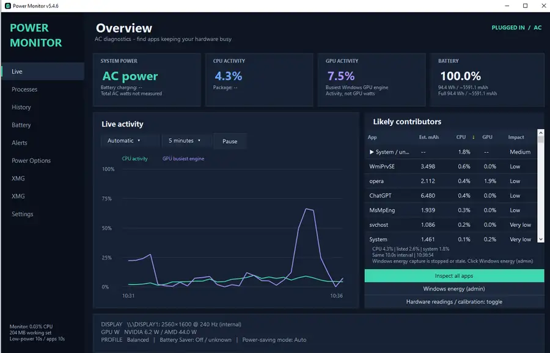
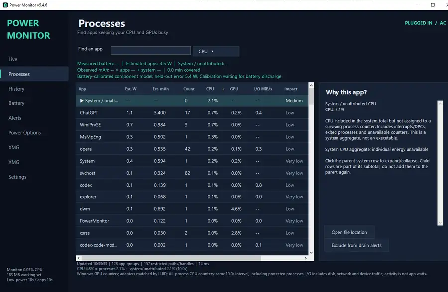
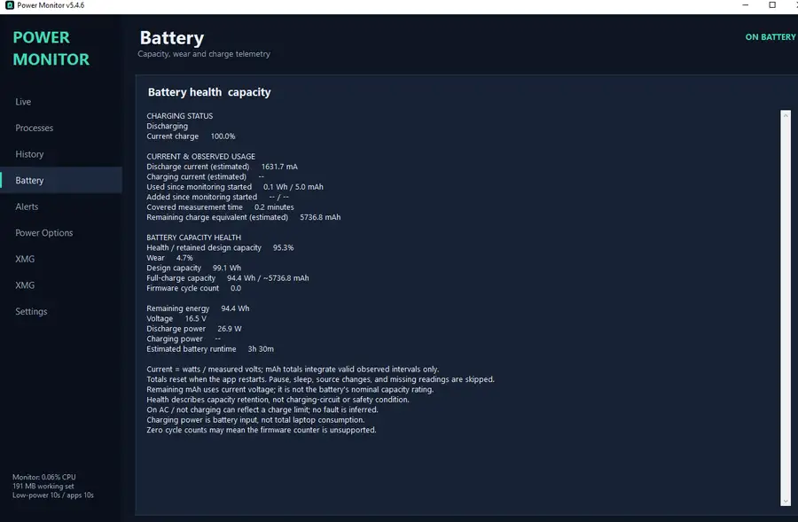
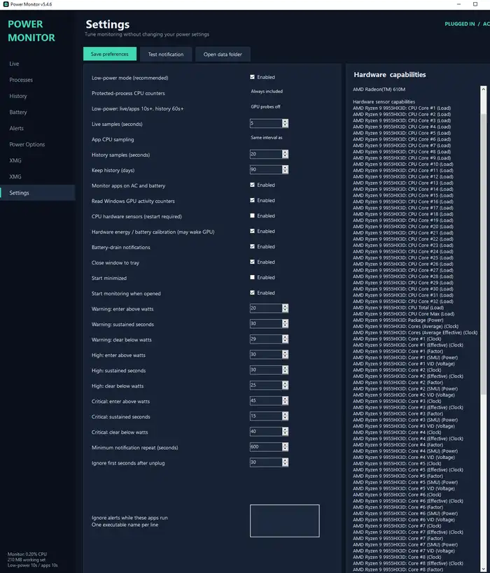

# Power Monitor

**Version 5.4.6 · Scott Sheen · Sheen Consulting International**

Power Monitor is a Windows desktop and tray application for understanding **battery drain, CPU/GPU activity, and which applications are keeping the system busy**. It combines live system telemetry, process-level diagnostics, battery health and runtime information, energy attribution, history, alerts, and optional hardware diagnostics in one Windows application.

Built in **C# with .NET 8 and Windows Forms**.

[Installation](install/README.md) · [Release notes](CHANGELOG.md) · [Development history](docs/DEVELOPMENT-HISTORY.md)

## Screenshots

### Overview


### Process activity


### Battery telemetry


### Settings and hardware capabilities



## Key features

- Live battery power, capacity, charging status, health, wear and session totals when supported by the machine.
- Process-level CPU activity, including protected Windows processes, grouped subprocesses and searchable details.
- CPU, GPU, estimated watts, estimated mAh and I/O views to help identify likely power contributors.
- Expandable system/unattributed CPU breakdown rather than hiding activity that cannot be assigned cleanly to one process.
- Windows energy attribution where available, with measured values kept distinct from estimates.
- Optional hardware energy diagnostics and battery-based calibration.
- SQLite history for longer-term power and activity tracking.
- Configurable battery-drain alerts and notification-area controls.
- Low-power monitoring mode designed to avoid making the monitoring tool itself a significant source of battery drain.
- Read-only XMG-specific diagnostics when available; an XMG laptop is not required.

## Technical highlights

This project is also a practical Windows diagnostics and systems-integration application rather than only a battery gauge.

- **C# / .NET 8 / Windows Forms** desktop application.
- Windows battery, power, process and performance telemetry.
- CPU, GPU and I/O process attribution, including fallback handling for restricted/protected processes.
- Windows E3 energy tracing through **ETW / TraceEvent** for supported energy data.
- Optional hardware telemetry using **LibreHardwareMonitor**.
- Battery-calibrated energy attribution while preserving measured, estimated and unattributed values separately.
- **SQLite** persistence for history, settings-related data and calibration.
- Configurable Windows notifications and background tray operation.
- Built-in regression/self-tests and UI smoke-test support.
- Defensive handling of unavailable sensors and unsupported firmware values instead of treating missing readings as zero.

## Requirements

- Windows 10 version 1809 or later, or Windows 11. Development verification has been on Windows 10; hardware capabilities vary.
- .NET 8 Desktop Runtime for a framework-dependent build.
- .NET 8 SDK or a compatible newer SDK to build from source.
- Some optional hardware readings require supported drivers or elevated access. Ordinary monitoring does not require administrator privileges.

## Build and run

From the repository folder in PowerShell:

```powershell
dotnet restore PowerMonitor.csproj
dotnet publish PowerMonitor.csproj -c Release -r win-x64 --self-contained false -o artifacts/PowerMonitor
.\run.ps1
```

Keep the complete published folder together. Exit any previous copy through its tray menu before starting another. By default, closing the window keeps the monitor running in the tray.

To create a Windows x64 package that includes the .NET runtime:

```powershell
dotnet publish PowerMonitor.csproj -c Release -r win-x64 --self-contained true -o artifacts/PowerMonitor-standalone
```

## Installation

See [install/README.md](install/README.md) for prerequisite checks, per-user installation, folder placement, updates and removal.

The install folder contains setup and prerequisite-check scripts. Compiled payloads are intended to be distributed separately through a binary GitHub Release rather than committed to the source repository.

## Measurements and limitations

Battery discharge watts are physical battery readings when supplied by Windows and the device firmware. Battery charging watts are power entering the battery and do not represent total wall power.

Process CPU, GPU and I/O activity help identify contributors. Activity scores are not measured per-app watts. Windows energy attribution, hardware-based allocation and battery-calibrated app estimates have separate assumptions and may leave system energy unattributed. Missing readings remain unknown rather than becoming zero.

GPU hardware polling can wake or retain a GPU and change its power consumption. Enable it deliberately in Settings for diagnostics. Reported driver readings are not guaranteed to be accurate. Calibration requires sufficient actual battery discharge data and variation; synthetic tests do not establish physical measurement accuracy.

The app does not automatically change power plans, terminate processes or change GPU settings. XMG-specific information is read-only and optional.

## Settings and local data

Settings, history, calibration and logs are stored under:

```text
%LOCALAPPDATA%\LaptopPowerMonitor
```

Low-power mode uses at least a 10-second live/CPU interval and a 60-second history interval. GPU activity counters are disabled in ordinary low-power mode. History retention defaults to 90 days.

Diagnostics and history can contain executable paths, process names and hardware details. Review these before attaching them to a public issue. Generated data and screenshots are excluded from source-control output folders.

## Verification

Publish first, then run the built-in regression checks:

```powershell
$exe = Join-Path $PWD 'artifacts\PowerMonitor\PowerMonitor.exe'
$report = Join-Path $PWD 'artifacts\self-test.txt'
Start-Process -FilePath $exe -ArgumentList "--self-test --output `"$report`"" -WindowStyle Hidden -Wait
Get-Content -LiteralPath $report
```

Tests cover alert thresholds, unknown values, persistence, CPU coverage and process identity, sorting, GPU mapping, energy conversion and calibration.

To capture the interface using isolated settings/history:

```powershell
$preview = Join-Path $PWD 'artifacts\ui-smoke'
Start-Process -FilePath $exe -ArgumentList "--ui-smoke --output `"$preview`"" -WindowStyle Hidden -Wait
```

UI capture samples the local machine. Hardware accuracy and battery behavior require separate verification on the target computer.

## Source layout

| Files | Purpose |
| --- | --- |
| `Program.cs`, `MainForm.cs`, `ProcessesView.cs`, `Theme.cs` | Startup and desktop interface |
| `Telemetry.cs`, `Native.cs`, `BatteryMetrics.cs` | Windows and battery measurements |
| `ProcessActivity.cs`, `ProcessCounterFallback.cs` | Process CPU, I/O and GPU activity |
| `WindowsEnergy.cs`, `HardwareEnergy.cs`, `EnergyCalibration.cs`, `PowerAttribution.cs` | Energy readings, tracing, calibration and estimates |
| `MonitorService.cs`, `HistoryStore.cs`, `Models.cs` | Sampling, persistence and settings |
| `SelfTests.cs`, `HardwareEnergyTests.cs`, `ActivityUiSmoke.cs` | Regression and interface checks |
| `assets/` | Application icon and editable SVG source |
| `docs/` | Development history and supporting documentation |
| `install/` | Installation, prerequisite-check and packaging scripts |

## Issues and feedback

When reporting a problem, include the Power Monitor version, Windows version and reproduction steps. Review diagnostic files for personal information before sharing them.

Development conventions and measurement rules are documented in [AGENTS.md](AGENTS.md).

## Version and authorship

The current version is **5.4.6**. `PowerMonitor.csproj` is the version source used by the executable and window title. See [CHANGELOG.md](CHANGELOG.md) for release notes.

Copyright © 2026 Scott Sheen / Sheen Consulting International.

Power Monitor is open source under the [MIT License](LICENSE). You may use, modify and redistribute the software subject to the terms of that license. Third-party packages remain governed by their own licenses; see [THIRD-PARTY-NOTICES.md](THIRD-PARTY-NOTICES.md).
